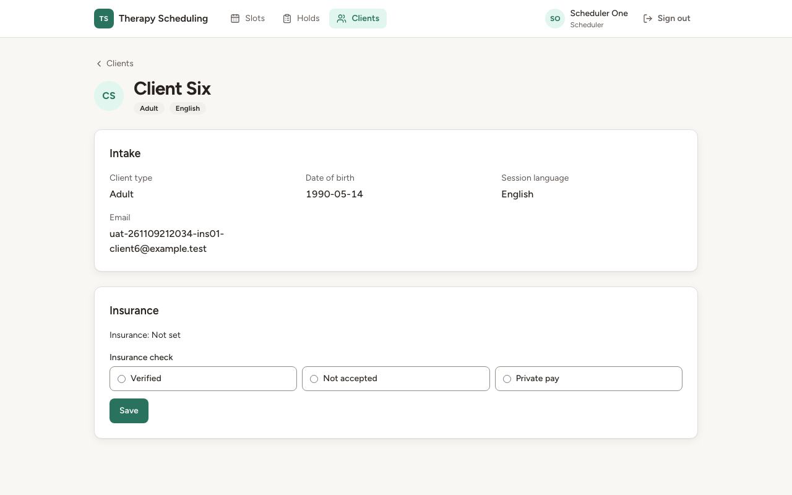
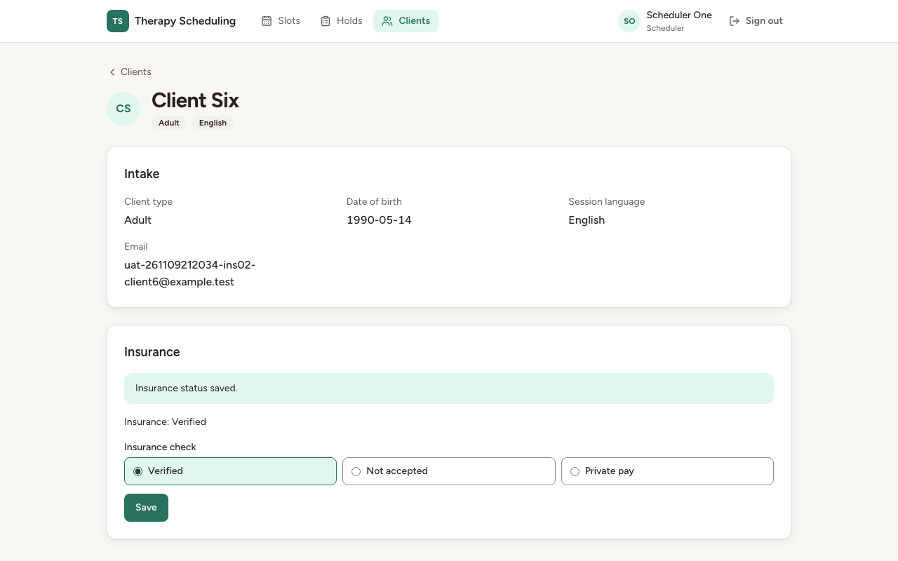
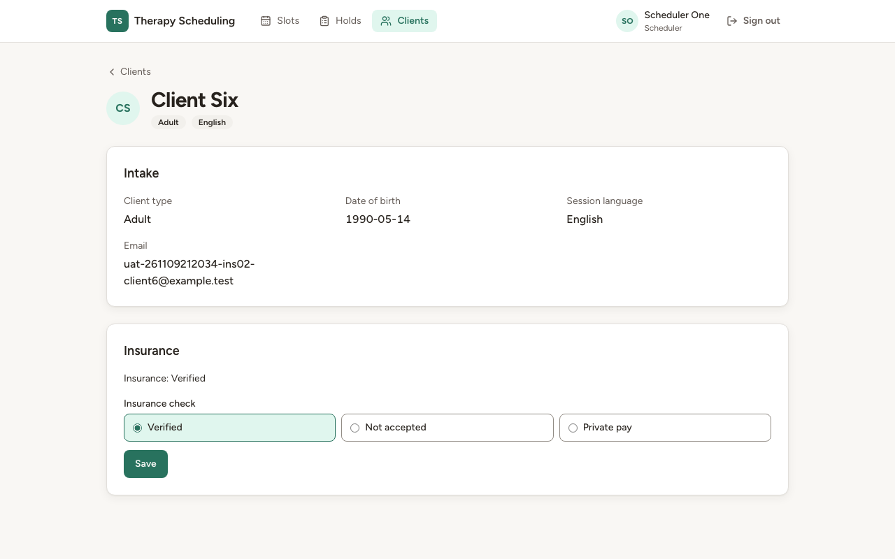
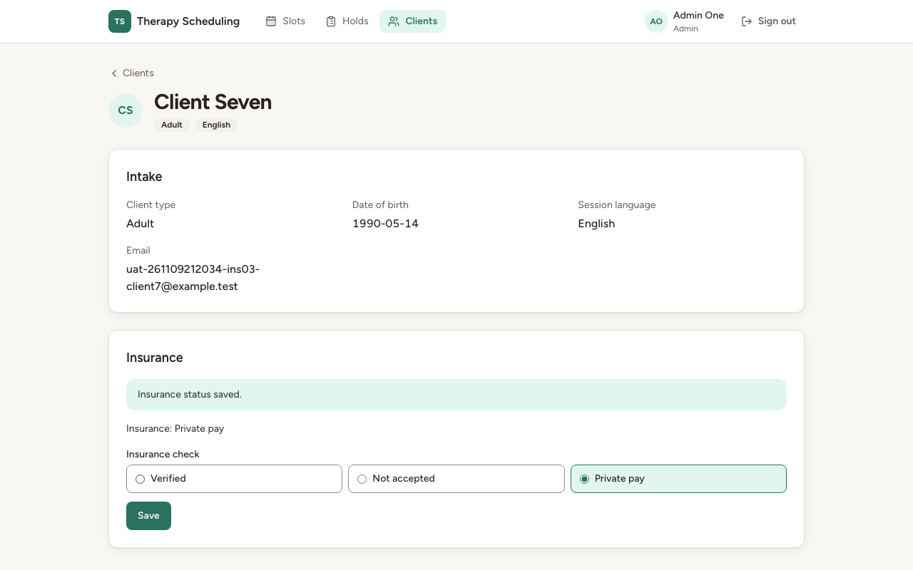
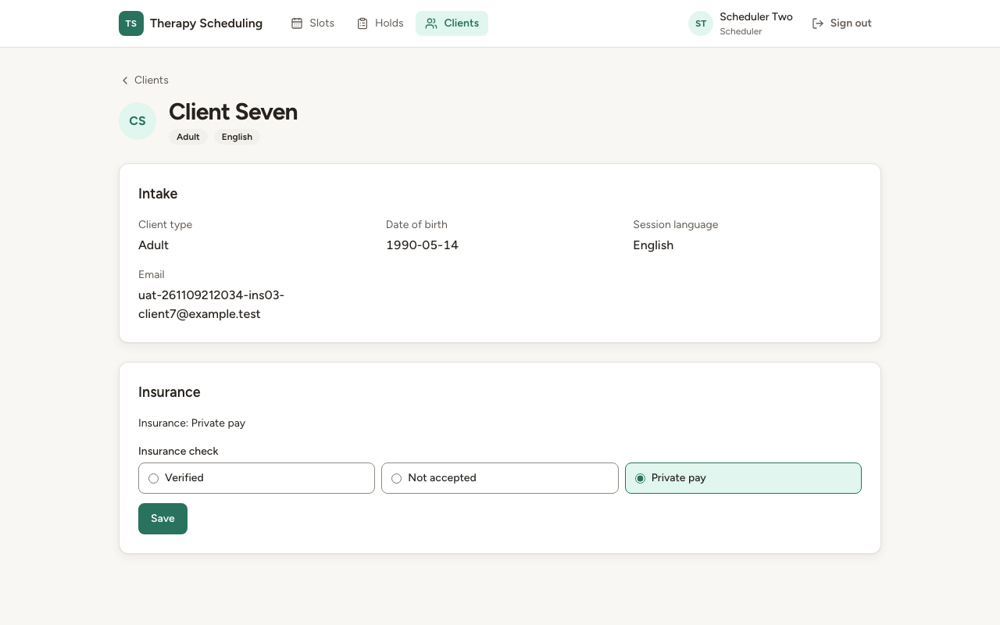
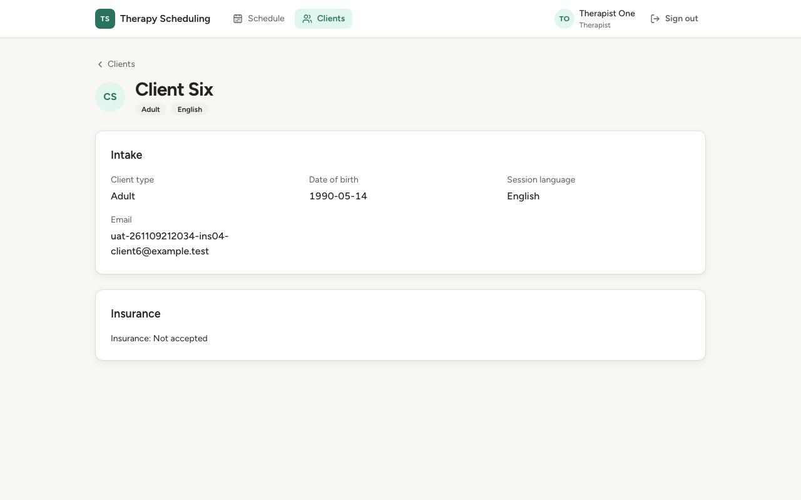
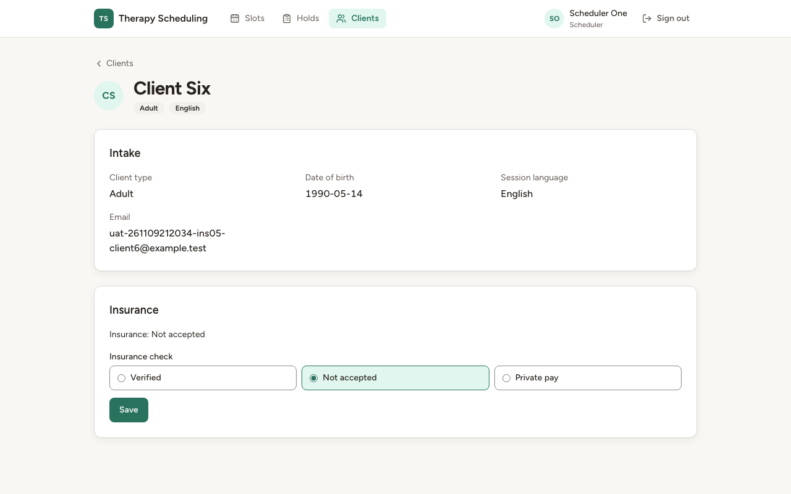
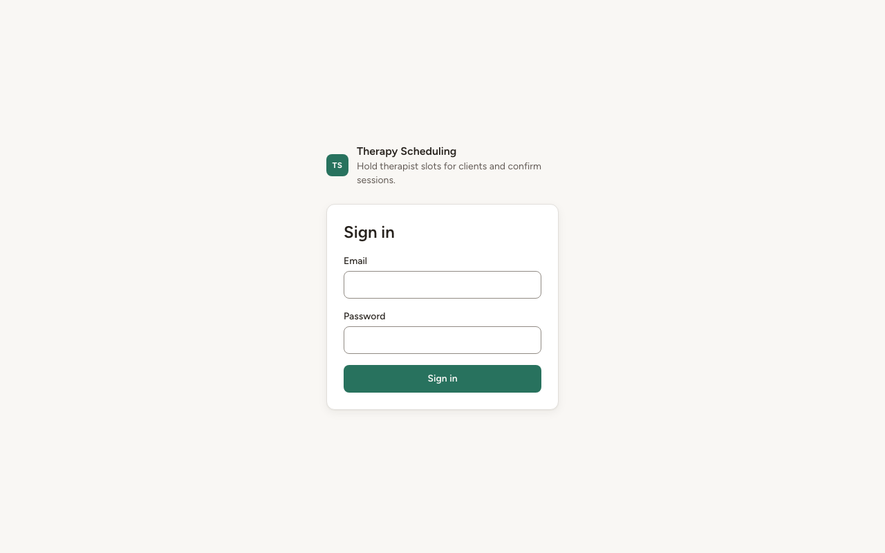

# Звіт UAT — 09.11.2026

- **Застосунок:** https://therapy-scheduling-factory.vercel.app (/api/health: коміт `4652f92`)
- **Код тестів:** `uat/insurance` @ `fa95cb2`
- **Прогін:** 09.11.2026, 23:20 (Київ), Playwright 31.6 с; AC: 6 — PASS 6, FAIL 0, NEEDS-HUMAN 0
- **Рецензент:** `claude-haiku-5-5`; суперечки → `claude-sonnet-5-5`. Разом за розбір: $0.0642 (ціни API; за підпискою — у межах ліміту плану)
- **Прибирання:** синтетичних uat-*@example.test видалено 0, лишилось 0, їхніх рядків, що лишились: 0
- **Відео й траси:** не в git — `test-results/` локально або артефакт CI; трасу відкриває `npx playwright show-trace <trace.zip>`

| AC | Перевірки | Агент | Підсумок | Чому | Playwright | Розбір |
|---|---|---|---|---|---|---|
| AC-INS-01 | пройшли | Haiku: PASS | **PASS** | R6: перевірки, агент і цитати збігаються | 2.2 с | $0.0024, 7.4 с |
| AC-INS-02 | пройшли | Haiku: PASS | **PASS** | R6: перевірки, агент і цитати збігаються | 4.9 с | $0.0030, 8.7 с |
| AC-INS-03 | пройшли | Haiku: PASS | **PASS** | R6: перевірки, агент і цитати збігаються | 5.5 с | $0.0030, 9.6 с |
| AC-INS-04 | пройшли | Haiku: PASS | **PASS** | R6: перевірки, агент і цитати збігаються | 2.2 с | $0.0020, 6.2 с |
| AC-INS-05 | пройшли | Haiku: PASS | **PASS** | R6: перевірки, агент і цитати збігаються | 3.4 с | $0.0020, 6.1 с |
| AC-INS-06 | пройшли | Haiku: NEEDS-HUMAN, Sonnet: PASS | **PASS** | R6: перевірки, агент і цитати збігаються | 2.5 с | $0.0517, 23.5 с |

## AC-INS-01 — PASS

**Тест:** AC-INS-01: статус ще ніхто не позначав — у картці «Insurance: Not set»

**Критерій** (requirements/33-planuvalnyk-poznachaie-status-perevirky.md):

> AC-INS-01: Дано картку client6 створено, і статус перевірки страхування ще ніхто не позначав. Коли scheduler1 відкриває картку client6. Тоді в картці показано «Insurance: Not set».

**Кроки:** ✔ Дано: картку client6 створено, і статус перевірки страхування ще ніхто не позначав → ✔ Коли: scheduler1 відкриває картку client6 → ✔ Тоді: в картці показано «Insurance: Not set»

**Агент (claude-haiku-5-5, PASS):** На кадрі сторінка картки Client Six, у шапці відображається «Scheduler One». У секції Insurance видно рядок «Insurance: Not set», текст збігається з критерієм посимвольно. Наявність запису в базі (client_insurance) не оцінювалась, бо це не видно на кадрі.

**Цитати агента, звірені зі сторінкою (aria):**
- «Scheduler One» — є на сторінці
- «Client Six» — є на сторінці
- «Insurance: Not set» — є на сторінці

**Правило:** R6: перевірки, агент і цитати збігаються

**Відео:** `test-results/artifacts/insurance-планувальник-і-а-d9c0f--картці-«Insurance-Not-set»-chromium/video.webm` · **траса:** `test-results/artifacts/insurance-планувальник-і-а-d9c0f--картці-«Insurance-Not-set»-chromium/trace.zip` (не в git)

**Рішення PM:** ☐ приймаю · ☐ відхилення від вимог (issue «Відхилення від вимог: AC-INS-01 — …») · @login: ____

## AC-INS-02 — PASS

**Тест:** AC-INS-02: scheduler1 позначає «Verified» — «Insurance status saved.», і після повторного відкриття «Insurance: Verified»

**Критерій** (requirements/33-planuvalnyk-poznachaie-status-perevirky.md):

> AC-INS-02: Дано картка client6 показує «Insurance: Not set». Коли scheduler1 позначає статус перевірки страхування «Verified». Тоді scheduler1 бачить повідомлення «Insurance status saved.», а картка client6 показує «Insurance: Verified» і після того, як scheduler1 відкриє її знову.

**Кроки:** ✔ Дано: картка client6 показує «Insurance: Not set» → ✔ Коли: scheduler1 позначає статус перевірки страхування «Verified» → ✔ Тоді: scheduler1 бачить повідомлення «Insurance status saved.», а картка client6 показує «Insurance: Verified» → ✔ Коли: scheduler1 відкриває картку client6 знову → ✔ Тоді: картка client6 показує «Insurance: Verified» і після того, як scheduler1 відкриє її знову

**Агент (claude-haiku-5-5, PASS):** На кадрі 1 (одразу після збереження) видно зелену плашку «Insurance status saved.» і рядок «Insurance: Verified» з вибраним Verified. На кадрі 2 (після повторного відкриття картки Client Six) у шапці видно «Scheduler One», а рядок «Insurance: Verified» присутній; плашки немає, що відповідає очікуванню, але саме відсутність ?notice= у адресі з кадру не видно, тому це не оцінюю.

**Цитати агента, звірені зі сторінкою (aria):**
- «Insurance status saved.» — є на сторінці
- «Insurance: Verified» — є на сторінці
- «Scheduler One» — є на сторінці
- «Insurance: Verified» — є на сторінці

**Правило:** R6: перевірки, агент і цитати збігаються

**Відео:** `test-results/artifacts/insurance-планувальник-і-а-20fd7-криття-«Insurance-Verified»-chromium/video.webm` · **траса:** `test-results/artifacts/insurance-планувальник-і-а-20fd7-криття-«Insurance-Verified»-chromium/trace.zip` (не в git)

**Рішення PM:** ☐ приймаю · ☐ відхилення від вимог (issue «Відхилення від вимог: AC-INS-02 — …») · @login: ____

## AC-INS-03 — PASS

**Тест:** AC-INS-03: admin1 змінює статус на «Private pay» — і admin1, і scheduler2 бачать «Insurance: Private pay»

**Критерій** (requirements/33-planuvalnyk-poznachaie-status-perevirky.md):

> AC-INS-03: Дано картка client7 показує «Insurance: Verified». Коли admin1 змінює статус перевірки страхування на «Private pay», а потім scheduler2 відкриває картку client7. Тоді і admin1, і scheduler2 бачать у картці «Insurance: Private pay».

**Кроки:** ✔ Дано: картка client7 показує «Insurance: Verified» → ✔ Коли: admin1 змінює статус перевірки страхування на «Private pay» → ✔ Тоді: і admin1, і scheduler2 бачать у картці «Insurance: Private pay» → ✔ Коли: а потім scheduler2 відкриває картку client7 → ✔ Тоді: і admin1, і scheduler2 бачать у картці «Insurance: Private pay»

**Агент (claude-haiku-5-5, PASS):** На кадрі frame-then-1.png у шапці видно «Admin One» (роль Admin), а в секції Insurance — «Insurance: Private pay». На кадрі frame-then-2.png у шапці видно «Scheduler Two» (роль Scheduler), і той самий рядок «Insurance: Private pay». Обидві видимі частини «Тоді» підтверджено дослівно; статус у базі не оцінювався, бо він не з кадрів.

**Цитати агента, звірені зі сторінкою (aria):**
- «Admin One» — є на сторінці
- «Insurance: Private pay» — є на сторінці
- «Scheduler Two» — є на сторінці
- «Insurance: Private pay» — є на сторінці

**Правило:** R6: перевірки, агент і цитати збігаються

**Відео:** `test-results/artifacts/insurance-планувальник-і-а-104a2-ать-«Insurance-Private-pay»-chromium/video.webm` · **траса:** `test-results/artifacts/insurance-планувальник-і-а-104a2-ать-«Insurance-Private-pay»-chromium/trace.zip` (не в git)

**Рішення PM:** ☐ приймаю · ☐ відхилення від вимог (issue «Відхилення від вимог: AC-INS-03 — …») · @login: ____

## AC-INS-04 — PASS

**Тест:** AC-INS-04: therapist1 бачить «Insurance: Not accepted» свого клієнта, змінити статус йому не запропоновано

**Критерій** (requirements/33-planuvalnyk-poznachaie-status-perevirky.md):

> AC-INS-04: Дано client6 — свій клієнт therapist1, і картка client6 показує «Insurance: Not accepted». Коли therapist1 відкриває картку client6. Тоді він бачить «Insurance: Not accepted», а змінити статус перевірки страхування в картці йому не запропоновано.

**Кроки:** ✔ Дано: client6 — свій клієнт therapist1, і картка client6 показує «Insurance: Not accepted» → ✔ Коли: therapist1 відкриває картку client6 → ✔ Тоді: він бачить «Insurance: Not accepted», а змінити статус перевірки страхування в картці йому не запропоновано

**Агент (claude-haiku-5-5, PASS):** На кадрі видно сторінку «Client Six» (картка Insurance) з рядком «Insurance: Not accepted» і користувачем «Therapist One» у шапці. У картці Insurance немає жодного вибору статусу та кнопки «Save», тож частина «змінити статус не запропоновано» підтверджується відсутністю елементів на кадрі.

**Цитати агента, звірені зі сторінкою (aria):**
- «Therapist One» — є на сторінці
- «Insurance: Not accepted» — є на сторінці

**Правило:** R6: перевірки, агент і цитати збігаються

**Відео:** `test-results/artifacts/insurance-терапевт-AC-INS--f4e52-татус-йому-не-запропоновано-chromium/video.webm` · **траса:** `test-results/artifacts/insurance-терапевт-AC-INS--f4e52-татус-йому-не-запропоновано-chromium/trace.zip` (не в git)

**Рішення PM:** ☐ приймаю · ☐ відхилення від вимог (issue «Відхилення від вимог: AC-INS-04 — …») · @login: ____

## AC-INS-05 — PASS

**Тест:** AC-INS-05: therapist1 напряму, в обхід сторінок, не змінює статус — scheduler1 бачить «Insurance: Not accepted»

**Критерій** (requirements/33-planuvalnyk-poznachaie-status-perevirky.md):

> AC-INS-05: Дано client6 — свій клієнт therapist1, і картка client6 показує «Insurance: Not accepted». Коли therapist1 напряму, оминаючи сторінки застосунку, пробує змінити статус перевірки страхування client6 на «Verified». Тоді статус не змінився: scheduler1 у картці client6 бачить «Insurance: Not accepted».

**Кроки:** ✔ Дано: client6 — свій клієнт therapist1, і картка client6 показує «Insurance: Not accepted» → ✔ Коли: therapist1 напряму, оминаючи сторінки застосунку, пробує змінити статус перевірки страхування client6 на «Verified» → ✔ Коли: scheduler1 відкриває картку client6 → ✔ Тоді: статус не змінився: scheduler1 у картці client6 бачить «Insurance: Not accepted»

**Агент (claude-haiku-5-5, PASS):** На кадрі сторінка картки Client Six (/clients/3ff863f6-…) у шапці видно «Scheduler One» з підписом «Scheduler», а в блоці Insurance — рядок «Insurance: Not accepted»; вибраний перемикач «Not accepted». Обидві видимі частини «Тоді» підтверджено дослівно. Частини про відхилену спробу і статус у базі не оцінювалися, бо вони не з кадрів.

**Цитати агента, звірені зі сторінкою (aria):**
- «Scheduler One» — є на сторінці
- «Insurance: Not accepted» — є на сторінці

**Правило:** R6: перевірки, агент і цитати збігаються

**Відео:** `test-results/artifacts/insurance-терапевт-AC-INS--b4f8c-ть-«Insurance-Not-accepted»-chromium/video.webm` · **траса:** `test-results/artifacts/insurance-терапевт-AC-INS--b4f8c-ть-«Insurance-Not-accepted»-chromium/trace.zip` (не в git)

**Рішення PM:** ☐ приймаю · ☐ відхилення від вимог (issue «Відхилення від вимог: AC-INS-05 — …») · @login: ____

## AC-INS-06 — PASS

**Тест:** AC-INS-06: без входу картка за прямим посиланням — лише сторінка входу, а scheduler1 бачить «Insurance: Verified»

**Критерій** (requirements/33-planuvalnyk-poznachaie-status-perevirky.md):

> AC-INS-06: Дано користувач не увійшов у застосунок, а картка client6 показує «Insurance: Verified». Коли він відкриває картку client6 за прямим посиланням. Тоді він бачить лише сторінку входу, статусу страхування й інших даних client6 не показано, а scheduler1 після цього бачить у картці client6 «Insurance: Verified».

**Кроки:** ✔ Дано: користувач не увійшов у застосунок, а картка client6 показує «Insurance: Verified» → ✔ Коли: він відкриває картку client6 за прямим посиланням → ✔ Тоді: він бачить лише сторінку входу, статусу страхування й інших даних client6 не показано → ✔ Коли: scheduler1 після цього відкриває картку client6 → ✔ Тоді: scheduler1 після цього бачить у картці client6 «Insurance: Verified»

**Агент (claude-sonnet-5-5, PASS):** На першому кадрі видно лише форму входу (Email, Password, Sign in) без «Insurance» і «Client Six». На другому кадрі в шапці «Scheduler One», у картці Client Six є рядок «Insurance: Verified».

Haiku сказав NEEDS-HUMAN, тож розбір повторив Sonnet; рішення агента — за Sonnet.

**Цитати агента, звірені зі сторінкою (aria):**
- «Sign in» — є на сторінці
- «Email» — є на сторінці
- «Password» — є на сторінці
- «Sign in» — є на сторінці
- «Therapy Scheduling» — є на сторінці
- «Hold therapist slots for clients and confirm sessions.» — є на сторінці
- «Scheduler One» — є на сторінці
- «Insurance: Verified» — є на сторінці

**Правило:** R6: перевірки, агент і цитати збігаються

**Відео:** `test-results/artifacts/insurance-планувальник-і-а-0b57c-бачить-«Insurance-Verified»-chromium/video.webm` · **траса:** `test-results/artifacts/insurance-планувальник-і-а-0b57c-бачить-«Insurance-Verified»-chromium/trace.zip` (не в git)

**Рішення PM:** ☐ приймаю · ☐ відхилення від вимог (issue «Відхилення від вимог: AC-INS-06 — …») · @login: ____

## Як читати підсумок

- **PASS** — автоматичні перевірки пройшли, агент-рецензент погодився з кадром, а кожну його цитату знайдено на сторінці.
- **FAIL** — впала автоматична перевірка. Агент цього не перекриває: невидимі вади (буфер обміну, база) він на кадрі не побачить.
- **NEEDS-HUMAN** — перевірки зелені, але агент не погодився або його цитати немає на сторінці. Часто це слабкий тест або розбіжність між текстом AC і тестом — питання до PM, а не обов'язково вада продукту.

Правила: R1: перевірка впала — FAIL завжди, агент не перекриває; R2: немає вердикту агента або кадру; R3: перевірки пройшли, агент не погоджується — вирішує людина; R4: цитати агента немає на сторінці (aria) — не підтверджено; R5: помилка сторінки або 5xx під час сценарію; R6: перевірки, агент і цитати збігаються.
